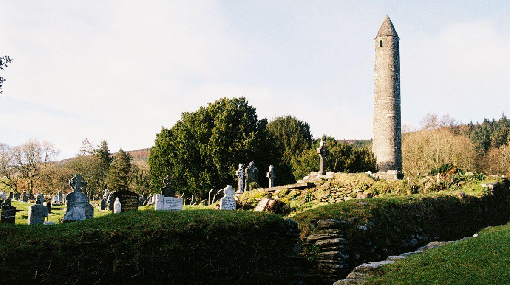

## Kingdom University  

**6-8 November 2026**  

Ticket sales are now live.     

  <a class="btn btn-warning shadow m-2 w-50" href="https://fienta.com/kingdom-univeristy-2026"><i class="fas fa-ticket-alt me-1 m"></i> Book Here!</a> 

Kingdom University is Drachenwald's Premier Learning Event. This year, it's hosted by Dun in Mara in the scenic and historical surrounds of the Glendalough Valley, a short walk from the remnants of the 6th Century Monastery of St. Kevin. We'll have a wide variety of classes, good food, merriment, and a warm welcome for all!  

### Location ###

The event will take place at Glendalough International Hostel, The Lodge, Sevenchurches Or Camaderry, Glendalough, Co. Wicklow, A98 F576  

### Transportation ###  

Please find information on transportation [here](https://drive.google.com/file/d/1Hi69kupER9odsLVeNBHuavmK0ZqGQ50F/view)

### Planned Activities & Schedule

**Activities**  

The overview schedule with classes, breaks and court times can be found [**here**](https://docs.google.com/spreadsheets/d/15gQ9A8qTyZJ4slndzvJFX-0iPQ8Ngcww/edit?gid=1520605284#gid=1520605284).   
Please find a list of classes with their descriptions [**here**](https://script.google.com/macros/s/AKfycbxQltp4m1H7PF0rALXtCNqNIRDrrLf5baw3MZZ8s-G9dYOR2KKmhJ7MefKWtUOA7lU/exec)  

**Site open/close:**  

Site opens at 18:00 on Friday.  
Site closes at 12:00 on Sunday. 

**Food schedule** 

Friday:  
- Travellers Fare at 19:00  

Saturday:  
- Breakfast at 08:00  
- Lunch at 13:00  
- Evening feast at 20:00  

Sunday:  
- Breakfast at 8:00  
  

### Costs

&euro;95.00 - SCA Member  
&euro;85.00 - Unwaged SCA Member  
&euro;47.50 - Children 13 and over  
&euro;45.00 - Day Trip  
Free - Children 12 and under  

Full tickets include beds in shared rooms (bedding provided, rooms en-suite) and meals (Friday evening, Saturday breakfast, lunch, and feast, Sunday breakfast). Day trips include all meals.  
  
(You can get [SCA Membership](https://membermojo.co.uk/scauk) easily - it costs £UK15 for a year's membership, so you'll recoup the cost quickly with a few practices or events!)  

### Staff

Event Co-Stewards: Máistir Aodh Ó Siadhail (aodhosiadhail@gmail.com), OP & Lady Gwerful An Filí (gwerful.an.fili@gmail.com)  
Head Cook:  Lady Erin of Dun in Mara  
Reservations: Lady Aoife ní Aodhagain  
Marshal-in-charge: Master Aodhan dha Cheist, OP  
Hall Steward: Lord Farraige de Roiste    
Herald in Charge: Viscountess Agnes Boncuer, OP  
Volunteer Coordinator: Lady Gytha ui Bhanain  
Royal Liaison: TBC  

  <a class="btn btn-warning shadow m-2 w-50" href="https://fienta.com/kingdom-univeristy-2026"><i class="fas fa-ticket-alt me-1 m"></i> Book Here!</a> 

 
